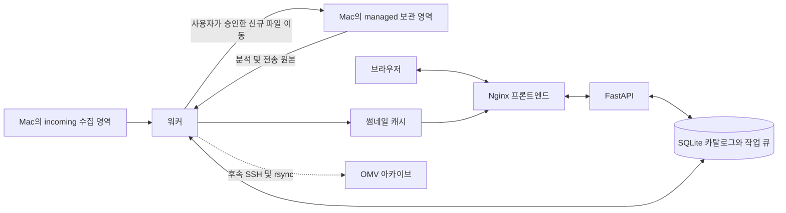

# Photo Saver 초기 설계

Photo Saver는 Apple Silicon Mac에서 촬영 영상을 수집하고, 사용자가 이벤트와 촬영 장비별로 배치한 원본을 OpenMediaVault(OMV)에 보관하는 개인용 웹 앱이다. Mac의 `incoming`에 모은 영상은 로컬 중복 검사 결과를 사용자가 확인한 뒤, 이동을 지시한 신규 파일만 `managed`로 옮긴다. OMV 전원이 꺼져 있어도 Mac에서 파일 분석, 분류, 전송 예약을 할 수 있다. 원본의 SHA-256과 OMV에 있는 사본의 검증 이력을 SQLite에 남긴다.

## 로컬 수집 및 이벤트 관리 실행

```sh
test -e .env || cp .env.example .env
mkdir -p incoming managed
docker compose up -d --build
```

기본 주소는 `http://127.0.0.1:8888`이다. 포트는 `.env`의 `PHOTO_SAVER_PORT`로 바꿀 수 있다. 기본 테스트 경로는 프로젝트 루트다. 촬영 시각에 시간대 정보가 빠지면 `PHOTO_SAVER_TIMEZONE`을 적용해 화면에 표시하고 사용자 확인 대기 상태로 둔다.

`incoming/`에 사진이나 영상을 넣고 **Incoming Library → 새로 고침**을 누른다. SHA-256 검사 결과와 썸네일을 확인한 뒤 신규 파일을 선택해 이동을 승인하면 워커가 해당 원본을 `managed/`로 옮긴다. **이벤트 관리**에서 원본을 이벤트나 소분류에 배정하고 확정한다. 카탈로그와 썸네일은 Docker 볼륨에 저장된다. 아카이브 페이지는 확정된 `Source` 배치를 표시하며, OMV 연결과 전송은 후속 구현 범위다.

## 실행 구성

초기 구현은 단일 사용자와 Mac 한 대를 기준으로 한다. Apple Silicon에서는 Docker Compose가 Python 이미지를 `linux/arm64`로 빌드한다. FastAPI와 워커는 이 이미지를 공유하며 별도 컨테이너에서 실행한다. Nginx가 정적 프론트엔드와 썸네일을 제공하고 API 요청을 FastAPI로 전달한다. 카탈로그와 작업 큐는 SQLite에 저장한다. [Docker 멀티 플랫폼 빌드](https://docs.docker.com/build/building/multi-platform/)



| 구성 | 책임 |
| --- | --- |
| 웹 | 사이드바 페이지 전환, `Incoming Library` 새로 고침과 이동 승인, 영상 분류 및 이벤트 배치, 아카이브 탐색과 전송 승인, 작업 상태 표시 |
| 워커 | 영상 탐색, 메타데이터 추출, 해시 계산, 썸네일 생성, SSH 접속 확인과 OMV 디렉터리 조회, 전송 및 원격 인덱싱 |
| `incoming` | 사용자가 장비에서 가져온 영상을 모으는 Mac의 수집 영역. 워커는 파일을 읽고 `managed`로 이동할 수 있도록 읽기·쓰기 권한을 가진다. |
| `managed` | 로컬 중복 검사 결과를 확인한 사용자가 이동을 승인한 신규 영상의 보관 영역. 워커는 파일 이동, 분석, OMV 전송을 위해 읽기·쓰기 권한을 가진다. |
| 데이터 볼륨 | 웹과 워커가 같은 Docker 명명 볼륨에서 SQLite 사용. WAL과 busy timeout을 설정하고 쓰기 트랜잭션은 짧게 유지 |
| 캐시 볼륨 | 워커가 썸네일을 쓰고 웹이 읽음. 필요하면 원본 영상에서 재생성 |

장시간의 파일 읽기와 네트워크 작업은 DB 트랜잭션 밖에서 수행한다. OMV 연결 확인과 전송은 워커 안에서 별도 실행으로 분리해 분석이 계속 진행되도록 한다. 초기 동시성은 분석 1개, OMV 작업 1개로 시작한다. 썸네일은 CPU로 생성하고 실제 촬영 샘플에서 처리 시간과 Mac의 디스크 사용량을 확인한다. [Docker 볼륨](https://docs.docker.com/engine/storage/volumes/), [SQLite WAL](https://sqlite.org/wal.html)

## Incoming Library 페이지

사용자는 장비에서 가져온 영상을 `incoming`에 모은다. 파일 인계에는 복사 중 임시 확장자를 사용한 뒤 최종 이름으로 바꾸거나, 별도 폴더에서 복사를 완료한 뒤 `incoming`으로 이동하는 방식을 쓴다.

1. 사이드바의 **Incoming Library**에서 **새로 고침**을 누르면 웹이 SQLite 작업 큐에 검사 작업을 등록한다. 기본 동작은 수동 요청으로 시작하며, 주기적 스캔과 파일 변경 감시는 비활성화한다. 워커는 일반 파일의 상태가 안정됐는지 확인한 뒤 SHA-256을 계산한다. 해시 계산 전후에 파일 ID, 크기, 수정 시각을 비교한다. 임시 파일과 심볼릭 링크는 건너뛰고 복사 중이거나 검사 중 변경된 파일은 다음 새로 고침 때 다시 확인한다.
2. 화면은 검사 진행 상태와 결과를 표시한다. 파일의 해시를 확인하면 사진 또는 영상의 썸네일을 생성해 이동 승인 전에도 보여 준다. 같은 해시의 파일은 캐시를 공유하며, 썸네일을 만들 수 없는 파일은 자리표시자로 표시한다. **이동 가능**에는 `managed`에 유효한 동일 사본이 없는 신규 영상이 표시된다. **중복**에는 `managed`의 동일 사본 또는 이번 검사에 포함된 동일 영상과 일치하는 파일이 표시된다. 이번 검사 안에서만 같은 해시가 발견되면 한 파일을 이동 후보로 제시하고 나머지에는 어떤 후보와 일치하는지 보여 준다. 검사 오류나 변경 중인 파일은 **확인 필요**로 표시한다. 중복 검사는 OMV의 전원 상태와 관계없이 진행한다.
3. 검사 결과가 표시된 시점에는 파일이 `incoming`에 대기한다. 사용자가 신규 항목을 선택하고 **선택 항목을 managed로 이동**을 누르면 별도의 이동 작업을 등록한다. 스크린샷 등 불필요한 사진은 **사진** 필터로 찾을 수 있다. 신규 사진과 중복 사진을 선택해 **사진 삭제**를 누르면 대상 목록을 보여 주고, 확인 후 `incoming`의 원본을 영구 삭제한다. 검사 이후 변경된 파일은 확인 필요로 표시한다.
4. 워커는 승인된 항목의 원본 상태와 `managed`의 중복 여부를 이동 직전에 다시 확인한다. 변경된 항목은 다음 검사 대상으로 돌리고 새 중복은 이동 대상에서 제외한다. 이동할 파일은 해시와 대상 경로를 SQLite에 기록한 뒤, 같은 파일시스템에서 대상 파일을 덮어쓰지 않는 원자적 이름 변경으로 `managed/<원본 파일 ID>/<원래 파일명>`에 옮긴다. 완료와 실패는 파일별로 표시한다. 재시작 시 이동 대기 기록의 양쪽 경로를 확인해, 대상 해시가 일치하면 완료로 복구하고 대상이 비어 있고 원본이 유효하면 이동을 재시도한다. 대상 충돌과 파일 누락은 사용자 확인이 필요한 상태로 표시한다.

검사 결과는 **표 보기**와 **카드 보기**로 전환할 수 있다. 썸네일을 클릭하면 원본을 바탕으로 한 큰 미리보기가 열린다. HEIC·HEIF는 브라우저에서 표시할 수 있도록 JPEG로 변환해 보여 주며, **원본 열기**에서 실제 파일을 열 수 있다. 동영상 재생은 브라우저의 코덱 지원에 따른다. 카드에서는 방향키로 이동하고 `Enter`로 미리보기를 연다. 미리보기에서는 `←`와 `→`로 현재 필터의 파일을 넘기고 `Delete` 또는 `Backspace`로 사진 삭제 확인을 연다. `Enter`로 확인하거나 `Esc`로 취소할 수 있다. 사진이 삭제되면 다음 파일이 표시된다.

같은 폴더의 이름이 일치하는 XMP는 원본과 연결한다. `파일명.HEIC.xmp`처럼 확장자까지 지정되면 해당 원본을 사용한다. XMP에 확장자 지정이 없고 같은 이름의 사진과 영상이 함께 있으면 유일한 사진을 우선한다. 이동이 승인되면 XMP 원본도 `managed`의 해당 파일 옆에 보관한다. 먼저 옮긴 원본의 XMP는 **XMP 연결**에 표시된 후보를 검토한 뒤 연결할 수 있다. 원본과 짝이 명확한 `.THM`과 `.LRV`는 원본의 이동 및 카탈로그 기록이 끝난 뒤 `incoming`에서 삭제한다. 이름이 여러 원본에 해당하거나 검사 후 변경된 파일은 확인할 수 있도록 남긴다.

## managed 영상 분석

1. 이동이 완료되면 `managed`의 원본을 분석한다. `ffprobe`로 컨테이너 및 스트림 태그, 영상 길이, 코덱, 해상도를 읽는다. 분석 전후에 열린 파일과 `managed` 경로의 파일 ID, 크기 및 시각을 비교한다. 변경되었으면 기존 결과를 폐기하고 해시를 다시 검증한다. [ffprobe 문서](https://ffmpeg.org/ffprobe.html)
2. 장비는 장비 식별자와 제조사·모델 태그, 사용자 등록 파일명 규칙 순으로 추정한다. 모델이 같은 장비가 여러 대 있거나 장비를 식별할 근거가 부족하면 사용자가 선택한다. 촬영 시각은 장비별 규칙에 따라 메타데이터에서 읽고, 시간대 근거가 있으면 UTC로 정규화한다. 시간대가 빠진 값과 파일 수정 시각을 사용한 추정값은 확인이 필요하다고 표시한다. 원시 태그, 추정 근거, 사용자 수정값은 따로 보관한다.
3. `incoming`에서 생성된 썸네일은 이동 후에도 재사용한다. 캐시에 없으면 사진을 축소하거나 FFmpeg로 영상의 대표 프레임 한 장을 추출한다. 캐시 키에는 SHA-256과 썸네일 생성 규칙 버전을 사용한다. 해시를 정상적으로 계산했지만 메타데이터가 부족한 영상은 사용자가 장비와 촬영 시각을 보완해 배치할 수 있다.

초기 지원 형식은 사진의 JPEG, PNG, WebP, HEIC·HEIF와 영상의 MP4, MOV다. 사진은 EXIF 촬영 시각과 촬영 장비를 읽고 회전을 반영한 썸네일을 만든다. 메타데이터가 없는 파일은 수정 시각을 참고값으로 표시하며, 사용자가 시각과 장비를 지정할 수 있다. 수동 새로 고침 시 이미 `managed`에 있는 파일도 카탈로그에 반영한다.

XMP의 `photoshop:DateCreated` 또는 `exif:DateTimeOriginal`은 촬영 시각 후보로 저장한다. 원본 촬영 시각이 없으면 XMP 시각을 참고하고, 원본의 현지 시각과 일치할 때 XMP의 UTC 오프셋으로 빠진 시간대를 보완한다. 원본과 시간대가 포함된 XMP 시각이 충돌하면 사용자가 **촬영 시각 지정**에서 출처를 선택한다. **이벤트 관리 → 전체 파일**에서는 파일명과 장비, XMP 제목·설명·키워드·장소·GPS 값을 검색할 수 있다. 확정 배치의 `Source`에는 XMP를 원본 옆에 표시한다.

## 이벤트 관리 페이지

사이드바의 **이벤트 관리** 탭에서 이벤트를 만들고 `managed`에 있는 푸티지를 분류한다. 왼쪽에는 이벤트와 소분류 목록을, 오른쪽에는 선택한 이벤트의 푸티지를 보여 준다. **미배정** 목록에서도 파일을 골라 이벤트에 직접 넣을 수 있다. 푸티지 목록에는 썸네일, 파일명, 촬영 시각과 근거, 장비, 중복 여부를 표시한다. 날짜와 장비로 좁혀 보고, 여러 파일을 선택해 한 번에 분류하거나 장비를 보정할 수 있다.

1. **이벤트 생성**에서 이름, 시작일, 종료일, 기준 시간대를 지정한다. 하루짜리 이벤트는 시작일과 종료일을 같은 날로 지정한다. 최상위 이벤트의 기본 폴더명은 시작일을 붙인 `YYMMDD_이벤트명`이다. 예를 들어 2026년 9월 3일에 시작하는 제주 여행은 `260903_제주여행`으로 표시한다.
2. **기간으로 모으기**는 이벤트에 지정한 시간대를 기준으로 시작일과 종료일 양쪽을 포함해 촬영일을 비교한다. 종료일 다음 날 0시부터는 기간 밖으로 처리한다. 촬영 시각이 확인되고 해당 기간에 속하는 미배정 푸티지는 이벤트의 배치 초안에 자동으로 추가한다. 여러 최상위 이벤트의 기간에 겹치는 파일은 직접 배정할 수 있다. 촬영 시각 확인이 필요한 파일은 **촬영 시각 지정**에서 EXIF 또는 영상 메타데이터 시각, 파일 수정 시각, 직접 입력을 선택한다. 시간대가 빠진 메타데이터에는 선택한 시간대를 적용한다. 저장한 시각은 **기간으로 모으기**에 사용할 수 있으며, 이미 배정된 파일은 현재 이벤트에 남는다.
3. **소분류로 분배**할 때는 최상위 이벤트 아래 한 단계의 소분류를 만들고, 부모 이벤트에서 선택한 파일에 **소분류로 이동**을 적용한다. 예를 들어 제주 여행의 푸티지 중 식당에서 찍은 파일만 `식당명` 소분류에 넣을 수 있다. 나머지 푸티지는 부모 이벤트에 직접 속하며, 소분류의 푸티지를 부모 이벤트로 되돌릴 수도 있다.
4. **배치 확정** 전에 자동 배정과 수동 분류 결과, 실제 아카이브 경로를 확인한다. 장비를 식별하지 못한 파일은 장비를 직접 지정하거나 `unknown`으로 명시적으로 분류할 수 있다. 확정한 배치는 아카이브 전송 페이지의 `Source`에 표시된다. 이벤트 안에서 푸티지를 배정하고 옮기는 작업은 SQLite 카탈로그에 기록한다.
5. **이벤트 수정**에서 최상위 이벤트의 이름, 시작일, 종료일, 시간대를 수정한다. 소분류는 이름을 수정할 수 있다. 기존 배정과 아카이브 폴더 키를 유지하며, 수정한 조건으로 새 파일을 모으려면 **기간으로 모으기**를 실행한다. **이벤트 삭제**는 최상위 이벤트와 그 소분류를 제거하고 배정된 파일을 미배정으로 돌려보낸다. 소분류만 삭제하면 배정된 파일은 상위 이벤트의 초안으로 돌아간다. 원본은 `managed`에 보존한다.

아카이브 상대 경로는 기존에 사용하던 두 가지 폴더 구조를 지원한다. `managed` 원본은 원본 파일 ID 기준 경로에 보관하며, 아카이브 폴더 이름에는 이벤트와 장비의 안전한 고정 경로 키를 사용한다. 소분류와 부모에 직접 속한 장비 폴더의 이름이 겹치면 경로 미리보기에서 충돌을 표시한다.

| 분류 | 아카이브 경로 예시 |
| --- | --- |
| 단일 이벤트 또는 대분류에 직접 배정 | `260903_제주여행/GoPro/GX010001.MP4` |
| 대분류 아래 소분류에 배정 | `260903_제주여행/식당명/iPhone/IMG_0420.MOV` |

## 이벤트 배치와 중복 처리

- 이벤트와 장비의 표시 이름은 편집할 수 있다. 아카이브의 목표 상대 경로는 `<이벤트 키>/<장비 키>/<원래 파일명>` 또는 `<대분류 이벤트 키>/<소분류 이벤트 키>/<장비 키>/<원래 파일명>`이다.
- 전송을 승인하기 전에 배치 경로, 예상 전송 바이트, 기존 사본으로 처리할 후보, 충돌을 보여 준다. 경로는 서버에서 생성하고 Unicode 및 대소문자 정규화 규칙으로 충돌 후보를 검사한다. 내용이 다른 동명 파일에는 해시 접미사를 붙이고, 접미사도 충돌하면 더 긴 접미사로 다시 경로를 계산한다. 승인한 목적지와 해시는 작업에 고정한다. 승인 이후 발견한 충돌은 새 경로를 보여 주고 다시 승인을 받는다.
- 바이트가 같은 영상은 SHA-256으로 묶는다. 파일명이 같아도 해시가 다르면 별개 영상이다. 파일명이 바뀌거나 여러 장비 폴더에서 가져온 경우에도 여러 원본 경로를 하나의 콘텐츠에 연결할 수 있다.
- 같은 목적지에 같은 해시의 사본이 있으면 OMV에서 다시 검증한 뒤 해당 사본에 연결한다. 다른 경로에 같은 사본이 있으면 해당 경로를 보여 주고, 사용자가 기존 경로를 카탈로그에서 참조하거나 원하는 이벤트 폴더에 별도 파일을 만들도록 선택한다. 기존 경로 참조를 선택하면 OMV의 물리 경로는 그대로 유지된다. 별도 파일이 필요하면 같은 OMV에서 검증된 사본을 복사해 네트워크 전송을 줄인다.
- 원격 인덱스에 기록된 SHA-256은 중복 후보를 찾는 데 사용한다. OMV가 꺼져 있거나 후보가 이동·변경되었을 때 전송 완료 판정을 보류한다.

## 사이드바와 아카이브 전송 페이지

웹 앱은 왼쪽 사이드바에서 **Incoming Library**, **이벤트 관리**, **아카이브 전송**, **설정** 페이지로 이동한다. 각 탭은 자체 URL을 가지며 현재 페이지를 사이드바에 표시한다. **아카이브 전송** 탭을 열면 본문 왼쪽의 `Source`와 오른쪽의 `Destination`에서 전송할 푸티지와 OMV의 저장 구조를 함께 탐색할 수 있다.

| 탐색기 | 표시 내용과 동작 |
| --- | --- |
| 왼쪽 `Source` | `managed`에 원본이 있고 사용자가 이벤트와 촬영 장비 분류를 확정한 배치만 `이벤트명 → [소분류 이벤트명 →] 촬영 장비 → 푸티지` 순서로 표시한다. SQLite 카탈로그의 배치와 원본 경로를 사용해 트리를 구성한다. 이벤트나 장비 폴더 전체 또는 개별 파일을 전송 대상으로 선택할 수 있다. |
| 오른쪽 `Destination` | 워커가 SSH로 조회한 OMV 아카이브 루트의 실제 폴더와 파일을 표시한다. 현재 경로를 보여 주고 폴더를 열 때 해당 디렉터리의 항목을 조회한다. 조회 범위는 설정된 아카이브 루트로 한정하며 임시 작업 영역과 심볼릭 링크는 목록에서 제외한다. |

`Source`의 폴더는 확정된 배치를 묶어 보여 주는 카탈로그 구조다. 영상 원본은 `managed/<원본 파일 ID>/<원래 파일명>`에 보관하고, OMV 전송 경로에는 이벤트와 장비의 고정 경로 키를 사용한다. 사용자가 `Source`에서 항목을 선택하면 전송 미리보기에서 실제 목적지 경로, 예상 전송량, 중복 후보와 충돌을 확인할 수 있다. 목적지는 OMV 아카이브 루트와 선택한 배치의 경로로 결정한다. 사용자가 승인하면 기존 전송 큐에 작업을 등록한다.

`Destination`에는 조회 중, 빈 폴더, 연결 실패를 구분해 표시하고, 연결 실패 시 **다시 연결**을 제공한다. OMV가 꺼져 있어도 `Source`에서 전송할 항목을 선택해 예약할 수 있다. 이때 원격 확인은 대기로 표시하고, 연결 후 워커가 실제 목적지와 충돌을 확인한다. 두 탐색기의 폴더 이동과 파일 선택은 키보드로도 할 수 있다.

## OMV 전송과 복구

1. 사용자가 기존 수단으로 OMV를 켠다. 승인된 작업이 있으면 워커가 백오프로 연결을 확인한다. OMV에 접속하면 SSH 호스트 키, 예상 볼륨 식별자와 아카이브 루트, 쓰기 권한, 여유 공간을 확인한다. 아카이브 데이터 디스크가 마운트되지 않은 상황에서는 전송을 대기시킨다.
2. 워커는 `managed` 원본 경로의 상태를 다시 검사한다. 변경되었거나 사라졌으면 `managed`에서 같은 해시로 검증할 수 있는 다른 사본을 찾고, 사용할 수 있는 사본이 없으면 사용자 확인을 요청한다. OMV에서 목적지나 중복 후보도 확인한다.
3. 새로 보낼 파일은 SSH를 통해 rsync로 OMV의 `.photo-saver/staging/<작업 ID>/`에 전송한다. 중단 시 같은 작업 ID와 `--partial-dir`로 재시도한다. 검증된 OMV 사본으로 별도 경로를 만들 때도 먼저 같은 작업별 임시 영역에 복사한다. [rsync 매뉴얼](https://download.samba.org/pub/rsync/rsync.1)
4. OMV에서 임시 파일 전체의 SHA-256을 계산한다. 일치하는 파일만 같은 파일시스템의 최종 경로에 게시한다. 초기에는 OMV 쪽 보조 스크립트가 일반 파일의 하드링크를 새 이름으로 생성하는 방식을 사용한다. 최종 경로가 이미 있으면 생성이 실패하므로 기존 파일이 보존된다. 임시 파일과 최종 경로의 디렉토리를 디스크에 동기화한 뒤 임시 이름을 제거한다. 하드링크와 디렉토리 동기화 지원 여부는 실제 OMV 볼륨에서 확인한다.
5. 최종 경로, 검증된 해시, 검증 시각을 SQLite에 기록한 뒤 작업을 완료한다. 게시 직후 연결이나 워커가 끊기면 다음 실행에서 최종 경로를 먼저 해시 검증하고 동일한 결과를 복구한다. 최종 경로에 다른 내용이 있으면 충돌로 표시한다. 해시가 불일치한 임시 파일은 재사용 대상에서 제외하고 제한된 횟수로 처음부터 다시 시도한다.

작업 상태는 `대기 → OMV 연결 대기 → 전송 → 검증 → 완료`로 관리한다. 재시도 가능한 장애는 마지막 오류와 다음 실행 시각을 기록하고 대기로 돌아간다. 권한 오류, 경로 충돌, 반복된 검증 실패는 사용자 확인이 필요한 상태로 표시한다. 웹은 배치별 완료 수와 파일별 상태를 보여 준다. 워커는 DB에서 작업을 원자적으로 선점하고 만료 시각이 있는 임대를 갱신한다. 재시작 뒤 만료된 작업은 원격 상태 확인부터 재개한다. OMV 작업은 동시에 하나만 실행한다. 전송은 작업별 임시 영역에서 재개하고, 인덱싱은 실패한 스캔 범위를 다시 처리한다.

## 원격 파일 인덱스

OMV가 켜져 있을 때 웹에서 기존 아카이브 스캔을 요청할 수 있다. SSH로 OMV 보조 스크립트를 실행해 지정한 루트의 일반 파일을 탐색한다. 임시 영역과 심볼릭 링크를 건너뛰고, 서버에서 해시를 계산해 상대 경로, 크기, 파일 ID, 수정 및 상태 변경 시각, SHA-256을 반환한다. 영상 데이터는 Mac으로 가져오지 않는다. 해시 계산 전후에 파일 상태가 바뀌면 해당 경로의 검증은 다음 스캔으로 미룬다.

첫 스캔은 전체를 해시한다. 이후 증분 스캔은 파일 상태가 바뀐 경로만 재해시하며, 필요할 때 전체 재검증을 실행할 수 있다. 스캔한 범위가 성공적으로 끝났을 때만 그 범위의 누락 기록을 `없음`으로 표시한다. 중간에 연결이 끊기면 이전 인덱스를 보존한다. 외부에서 OMV 파일을 옮기거나 수정할 수 있으므로 각 기록에 최근 검증 시각을 보여 주고, 인덱스 후보를 실제 배치에 사용할 때는 해당 사본의 해시를 다시 확인한다.

## 데이터 모델

| 엔터티 | 주요 데이터 |
| --- | --- |
| `media_content` | 콘텐츠 ID, 고유 SHA-256, 크기, 영상 기술 정보, 썸네일 키 |
| `source_file` | 원본 파일 ID, `incoming` 상대 경로, 원래 파일명, `managed` 상대 경로, 파일 상태, 최근 검사 결과와 중복 기준 파일, 이동 상태, 콘텐츠 ID, 원시 태그, 추정 결과, 분석 상태 |
| `device` | 표시 이름, 고정 폴더 키, 장비 식별 규칙, 기본 촬영 시간대 |
| `event` | 표시 이름, 고정 폴더 키, 부모 이벤트 ID, 최상위 이벤트의 시작일·종료일·시간대, 메모 |
| `placement` | 이벤트, 장비, 콘텐츠, 입력 파일, 수정한 분류값, 배치 확정 상태, 목표 경로, 배치 방식, 연결된 원격 사본 |
| `remote_file` | 저장소 ID, 상대 경로, 파일 상태, 원격 SHA-256, 검증 시각과 존재 상태 |
| `job` | 작업 유형, 배치 ID, 고정된 작업 입력, 상태, 시도 횟수, 다음 실행 시각, 임대 만료 시각, 마지막 오류 |

원격 사본은 `(저장소 ID, 상대 경로)`를 고유하게 관리하고 SHA-256에 검색 인덱스를 둔다. 활성 전송에는 같은 저장소와 목표 경로를 중복 예약할 수 없게 한다. 촬영 시각 및 장비의 최종 분류는 필요에 따라 파일 또는 배치에서 수정할 수 있으며, 같은 해시를 가진 다른 배치의 설정과 독립적이다.

## 설정 페이지

- **스토리지 연결**에서 IPv4 또는 IPv6 주소와 `/`로 시작하는 원격 아카이브 루트를 등록하고 확인한다. SSH 계정명은 `.env`의 `PHOTO_SAVER_STORAGE_USER`에 넣고 Compose를 다시 적용한다. 계정명과 공개키는 고정된 `***`로 표시한다.
- **공개키 생성**으로 로컬 Ed25519 키 쌍을 만든다. **공개키 복사**로 키마다 한 번 클립보드에 복사해 스토리지의 해당 SSH 계정에 등록한다. **공개키 재생성**으로 새 키 쌍을 만들면 복사 완료 상태가 초기화되어 다시 한 번 복사할 수 있다. 재생성한 공개키는 스토리지 계정에 다시 등록해야 한다. IP와 키 쌍은 설정 전용 Docker 볼륨에 저장되며, 개인 키는 브라우저에 전달하지 않는다.
- **접속 테스트**는 저장된 IP의 22번 포트에 연결해 `.env` 계정과 생성한 키로 공개키 인증을 확인한다. 처음 연결할 때 스토리지에서 확인한 서버 호스트 키 지문과 화면의 지문을 비교한 뒤 확인한다. 이후 테스트는 설정 볼륨에 저장한 호스트 키로 서버를 검증한다.
- **DB 백업 다운로드**는 SQLite Online Backup API로 이벤트와 배치가 담긴 카탈로그 파일을 만든다. **복원**은 검증된 백업의 카탈로그 데이터로 교체한다. 스토리지 설정과 원본 파일은 별도로 보관된다. 파일 작업이 진행 중이면 작업이 끝난 뒤 백업 또는 복원을 실행한다.

## 운영 설정

- 웹 포트는 Mac의 `127.0.0.1`에 바인딩한다. OMV에는 비루트 전용 SSH 계정을 두고 아카이브 루트에 필요한 권한만 부여한다. API는 설정 볼륨의 개인 키와 확인된 호스트 키로 접속 테스트를 실행한다. 전송 워커는 이 정보를 읽기 전용으로 사용하고 SSH 호스트 키 확인을 강제하도록 설계한다. [OpenSSH 설정](https://man.openbsd.org/ssh_config#StrictHostKeyChecking)
- 입력 파일명은 데이터로 취급한다. FFmpeg 및 rsync는 인자 배열로 실행하고, SSH 보조 스크립트에는 검증된 작업 데이터를 전달한다. 원격 스크립트는 정규화한 경로가 설정된 아카이브 루트 안에 있는지 확인하고 심볼릭 링크를 통한 경로 접근을 차단한다.
- Compose는 `.env`에서 Mac의 공통 상위 경로 `PHOTO_LIBRARY_ROOT`와 그 아래 두 영역의 상대 경로 `INCOMING_DIR`, `MANAGED_DIR`를 읽는다. 예를 들어 `PHOTO_LIBRARY_ROOT=/Volumes/Media/PhotoSaver`, `INCOMING_DIR=from-devices`, `MANAGED_DIR=processed`로 지정할 수 있다. 두 상대 경로의 기본값은 각각 `incoming`, `managed`다.
- Compose는 Docker Desktop이 공유할 수 있는 `PHOTO_LIBRARY_ROOT`를 워커의 `/library`에 하나의 읽기·쓰기 바인드 마운트로 연결한다. 워커는 `/library`를 기준으로 두 상대 경로를 해석한다. 시작할 때 두 경로가 상위 경로 안의 서로 겹치지 않는 디렉터리이고 같은 파일시스템에 있으며, 워커 계정에 두 영역의 읽기·쓰기 권한이 있는지 확인한다. API는 원본 미리보기를 위해 `incoming`만 읽기 전용으로 마운트하며, 최근 검사 결과에 있는 원본의 파일 상태를 확인한 뒤 응답한다.
- 워커는 사용자가 이동을 승인한 신규 원본을 `incoming`에서 `managed`로 옮기고, 삭제를 승인한 `incoming` 사진을 제거한다. `managed` 원본과 OMV 아카이브의 삭제는 운영자가 관리한다. 앱은 자신이 생성한 임시 전송 파일을 정리한다.
- 영상, 썸네일, DB, 절대 경로가 들어간 설정, SSH 키는 GitHub에 올리지 않는다. SQLite 카탈로그는 Online Backup API로 별도 백업한다. 카탈로그 복구 시 이벤트와 배치 이력을 복원할 수 있으며, OMV 스캔으로 원격 파일 인덱스를 다시 구축할 수 있다. [SQLite 백업 API](https://sqlite.org/backup.html)

## 초기 구현 순서와 완료 기준

| 단계 | 완료 기준 |
| --- | --- |
| 1. 수집과 분석 | Apple Silicon Mac에서 `.env`에 지정한 두 영역을 Compose로 마운트하고 워커가 두 영역에 쓸 수 있는지 확인한다. `Incoming Library`의 수동 새로 고침은 검사 결과와 썸네일을 보여 주며, 이름이 달라도 SHA-256이 같은 파일을 중복으로 표시한다. 사용자 지시 후 선택한 신규 파일만 `managed`로 옮겨 메타데이터를 추출하고 썸네일을 재사용한다. 중복과 선택하지 않은 파일은 `incoming`에 남는다. 이동 직후 워커가 재시작해도 카탈로그가 `managed` 경로를 복구한다. |
| 2. 이벤트 관리 | 시작일과 종료일을 모두 포함해 `managed` 푸티지를 이벤트에 자동 배정하고, 기간이 겹치거나 촬영 시각이 불확실한 파일은 수동으로 배정한다. 선택한 파일을 소분류로 일괄 이동하거나 부모로 되돌린다. 재시작 뒤에도 초안을 열 수 있고, 확정한 배치는 `Source`에 두 가지 이벤트 계층을 반영해 표시된다. |
| 3. 아카이브 탐색과 전송 | 사이드바의 아카이브 전송 페이지에서 `Source`의 확정 배치를 선택하고 `Destination`의 실제 OMV 폴더를 탐색한다. 미리보기에서 충돌과 기존 사본 후보를 확인하고 전송을 승인한다. OMV가 꺼진 동안은 작업을 대기시키고 연결이 끊기거나 게시 직후 워커가 재시작해도 복구한다. 원격 해시가 일치한 경우에만 완료로 기록한다. |
| 4. 기존 아카이브 인덱싱 | 기존 사본을 찾아 전송 없이 재사용하거나 OMV 내부에서 복사한다. 원격에서 변경되거나 사라진 파일은 재검증에 반영된다. 중단된 스캔은 이전 기록을 보존한다. |

구현 착수 시 실제 장비별 영상 샘플과 시간대 규칙, OMV 아카이브 경로와 파일시스템, OMV에서 사용할 rsync 및 보조 스크립트 실행 환경을 확인한다.
