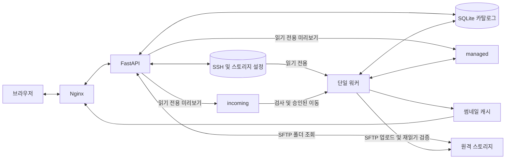

# 시스템 구조

## 실행 서비스

Photo Saver는 로컬 사진·영상을 검사하고 이벤트별로 분류한 뒤 OMV 같은 SSH/SFTP 스토리지에 복사하는 단일 사용자 웹 앱이다. [compose.yaml](../compose.yaml)에 세 서비스를 정의한다.

| 서비스 | 실행 방식 | 책임 |
| --- | --- | --- |
| `frontend` | `nginx:alpine` | HTML·CSS·JavaScript, 썸네일 제공, `/api/` 프록시 |
| `api` | `photo-saver-backend`, Uvicorn `api:app` | 화면 상태, 이벤트·배치 관리, 작업 등록, SSH 설정·접속 테스트, 원격 폴더 조회, 파일 기록, 백업·복원 |
| `worker` | 같은 백엔드 이미지의 `python worker.py` | 로컬 검사·분석·이동·삭제·XMP 연결과 원격 업로드 |

기본 웹 주소는 `http://127.0.0.1:8888`이다. API와 워커는 Python 3.12 기반 이미지를 공유한다. Compose에 `platform` 고정은 없으며 Docker 실행 환경의 기본 아키텍처를 사용한다. 파일 처리 코드는 Linux의 `renameat2`, `/proc/self/fd`, `fcntl`을 사용하므로 Mac에서도 백엔드를 Linux 컨테이너에서 실행한다.

SSH 설정·접속 테스트와 Destination 폴더 조회는 **API 프로세스**에서 실행한다. 업로드는 워커에서 실행한다. OMV 연결 없이 로컬 검사와 이벤트 관리를 사용할 수 있다.

## 저장 영역과 권한

| 영역 | API | 워커 | Nginx |
| --- | --- | --- | --- |
| 호스트 라이브러리 루트 → `/library` | 마운트 없음 | 읽기·쓰기 | 없음 |
| 호스트 Incoming → `/incoming-preview` | 읽기 전용 | `/library` 아래에서 접근 | 없음 |
| 호스트 Managed → `/managed-preview` | 읽기 전용 | `/library` 아래에서 접근 | 없음 |
| `catalog` 볼륨 → `/data` | 읽기·쓰기 | 읽기·쓰기 | 없음 |
| `settings` 볼륨 → `/settings` | 읽기·쓰기 | 읽기 전용 | 없음 |
| `thumbnails` 볼륨 → `/thumbnails` | 마운트 없음 | 읽기·쓰기 | 읽기 전용 |
| `frontend/` → 정적 웹 루트 | 없음 | 없음 | 읽기 전용 |

`incoming`과 `managed`는 겹치지 않는 같은 파일시스템의 디렉터리여야 한다. 앱으로 이동한 원본은 `managed/<파일 ID>/<원래 파일명>`에 둔다. 이벤트 폴더는 DB에서 구성하는 논리적 경로이며 이벤트 수정만으로 로컬 원본을 재배치하지 않는다.

## 처리 흐름

1. 브라우저가 검사 요청을 보내면 API가 `jobs`에 `scan` 작업을 등록한다.
2. 워커가 `managed`와 `incoming`을 검사하고 해시·메타데이터·검사 결과를 SQLite에 저장한다. 썸네일은 별도 볼륨에 쓴다.
3. 사용자가 신규 파일 이동을 지시하면 `move` 작업이 파일 상태와 중복을 다시 확인하고 원본을 이동한다.
4. 사용자가 이벤트·소분류·장비·촬영 시각을 정리하고 배치를 확정한다. 이 분류는 `media`와 `events`에 기록한다.
5. Source는 확정한 항목의 논리적 트리를 보여 준다. Destination은 API가 SFTP로 조회한 실제 원격 폴더다.
6. 업로드 요청 때 API가 소스 경로·대상 경로·해시·연결 설정 식별자를 작업 입력에 고정한다. 워커가 파일별로 전송·검증하고 `archive_entries`에 결과를 기록한다.

프론트엔드는 빌드 도구나 프레임워크 없이 [app.js](../frontend/app.js)에서 화면을 렌더링한다. `#incoming`, `#events`, `#archive`, `#catalog`, `#settings` 해시 경로를 사용하고 REST API를 호출한다. 작업 상태는 API를 반복 조회해 갱신하며 WebSocket이나 서버 푸시는 사용하지 않는다.

## 작업과 DB 동시성

지원 작업은 `scan`, `move`, `delete`, `xmp-link`, `upload`, `offload`, `remote-index`, `reset-all`다. `jobs`의 부분 유일 인덱스 `one_active_job`과 등록 함수가 전체 작업 중 `queued` 또는 `running`인 작업을 **하나만** 허용한다. 워커는 하나의 루프에서 작업을 순차 실행하며, 작업이 없으면 0.4초 간격으로 확인한다.

워커 프로세스는 `/data/worker.lock`에 비차단 배타 잠금을 건다. 재시작 시 `running` 작업을 `queued`로 돌리고 해당 처리기를 다시 실행한다. 파일별 처리 결과와 실제 로컬·원격 파일 상태를 다시 확인하는 방식이며 작업 임대, 자동 네트워크 재시도, 병렬 분석·전송은 구현하지 않았다.

SQLite는 WAL, 외래 키 검사, 10초 연결 대기 시간을 사용한다. 쓰기는 `BEGIN IMMEDIATE`, 읽기는 `BEGIN`으로 시작한다. 일반 접근은 카탈로그 공유 파일 잠금을 사용하고 백업·복원은 배타 잠금을 사용한다. 파일 해시와 네트워크 전송 전체를 하나의 DB 트랜잭션으로 묶지 않는다.

## 모듈 책임

| 파일 | 책임 |
| --- | --- |
| [api.py](../backend/api.py) | 앱 수명주기, 화면 상태, Incoming·managed 원본/미리보기, 이벤트·배치·사용자 보정, 작업 등록·취소 |
| [devices.py](../backend/devices.py) | 원래 장비명별 이름 규칙, 공통 이름 결정, 조회·변경·충돌 검사 |
| [resets.py](../backend/resets.py) | incoming·SSH를 보존한 managed·캐시·임시 데이터·카탈로그 삭제, 중단 후 삭제 재개 |
| [catalog.py](../backend/catalog.py) | DB 스키마·초기화·부분 마이그레이션·트랜잭션·작업 등록 |
| [worker.py](../backend/worker.py) | 라이브러리 검증, 검사·이동·삭제·XMP 처리, 단일 작업 루프 |
| [media.py](../backend/media.py) | 안전한 파일 접근·해시·이동, 사진·영상 분석, 썸네일 |
| [companions.py](../backend/companions.py) | XMP 파싱과 원본 후보 매칭 |
| [archive.py](../backend/archive.py) | 연결 설정 식별자, 안정적 스토리지 ID 해석, Paramiko 연결, 루트 제한 폴더 조회와 단일 파일 SFTP 다운로드 |
| [transfers.py](../backend/transfers.py) | 전송 입력 확정, SFTP 전송·검증·취소, 파일별 이력과 `remote_files` 갱신 |
| [remote_index.py](../backend/remote_index.py) | 원격 아카이브 전체·폴더별 증분 인덱싱(SFTP 탐색, SSH/SFTP 해시, 범위 내 `missing` 판정) |
| [offload.py](../backend/offload.py) | 실시간 SFTP 확인 기반 로컬 원본·XMP 안전 비우기(`archived` 전환)와 중단 재개 |
| [settings.py](../backend/settings.py) | 저장소 주소·루트, SSH 키·호스트 신뢰, DB 백업·복원 |
| [records.py](../backend/records.py) | 로컬 파일·업로드 이력·원격 인덱스의 읽기 전용 검색·집계 |

파일과 DB의 상세 규칙은 [미디어 처리](media-pipeline.md), [아카이브와 스토리지](archive-and-storage.md), [데이터 모델](data-model.md)을 참고한다.
