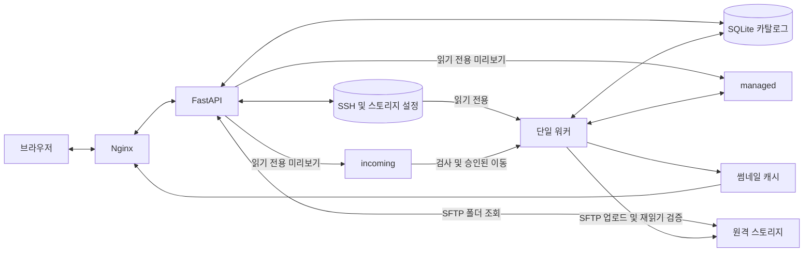

# 시스템 구조

## 선택적 OMV 시작 경로

`storage_wake.py`가 설정 snapshot/불투명 revision, SQLite admission·UUID 별칭·취소, 단일 시도 ledger와 워커 상태 기계를 담당한다. API는 설정 공유 잠금을 해제한 뒤 DB admission을 수행하고 네트워크를 호출하지 않는다. worker는 기존 remote 슬롯에서만 실행하며 기존 local 슬롯과 병행한다. 모든 설정/DB/catalog 잠금 획득은 비차단 재시도와 짧은 control tick으로 제한한다. 설정·취소·shutdown·원래 deadline을 반복 확인하고 네트워크 중 DB 트랜잭션을 유지하지 않는다.

각 HA GET/POST와 SSH probe는 `storage_wake_io.py`의 일회성 subprocess다. argv는 Python·모듈 경로뿐이고 비밀은 서버 메모리의 stdin pipe로만 전달한다. HA 환경변수를 child 환경에서 제거하고 stderr를 버린다. stdout은 작은 typed JSON만 사용한다. parent는 최대 250ms communicate 구간 사이에 control을 확인하고 종료 시 kill/reap한다. child도 원래 요청 slice의 독립 watchdog을 사용하며 I/O마다 최대 5초 또는 남은 전체 예산으로 제한한다. DNS·SSH banner/auth/SFTP/root 작업의 합산 지연도 subprocess 종료로 제한한다. SSH child는 read-only settings SH를 유지하고 기존 archive_connection의 신뢰·인증 정책을 재사용한다.

intent-before-effect를 DB에 저장하고 재시작은 원래 deadline으로 관찰만 재개한다. graceful stop은 현재 I/O를 회수하고 ledger를 종료 처리하지 않아 다음 worker가 재개할 수 있다. 사용자 취소는 별개이며 child 종료 전 running 레인을 해제하지 않는다. 설정 revision이 바뀌면 이전 대상 대기를 중지하고 새 대상에 요청을 옮기지 않는다. 마지막 확인 이후 이미 시작한 네트워크 요청은 소급 취소할 수 없으며 exactly-once 전달을 주장하지 않는다. 프런트엔드는 GET 상태 복구와 기존 연결 generation guard를 사용하고 render 자체에서 wake/refresh 요청을 시작하지 않는다.

## 기기 업로드 경로

API는 Incoming을 /incoming-upload에 별도 읽기·쓰기로 마운트한다. 기존 /incoming-preview와 /managed-preview의 읽기 전용 권한은 유지한다. [uploads.py](../backend/uploads.py)는 검증·스트리밍 청크·세션 잠금·원자적 게시·유휴 정리를 담당하고 [media.py](../backend/media.py)의 rename_noreplace를 공유한다. 새 패키지나 DB 테이블은 없다.

세션은 Incoming 내부 .photo-saver-uploads/의 ID별 .part/.json/.lock 파일로 영속화한다. staging은 0700이며 디렉터리 fd와 O_NOFOLLOW로 링크 경유를 차단한다. 세션 flock은 비차단이고 완료 시 대상 디렉터리 잠금과 NFC/casefold 충돌 검사 후 renameat2(RENAME_NOREPLACE)로 게시한다. 중단된 청크는 시작 크기로 잘라 되돌린다.

기기 업로드는 브라우저의 독립 상태이므로 로컬/원격 워커 레인을 점유하지 않는다. 검사는 숨김 staging을 건너뛰어 업로드와 병렬 실행할 수 있다. 업로드 완료 후 선택적으로 local scan을 등록하며 진행 중인 local/exclusive 작업이 있으면 사용자에게 수동 검사를 안내한다. API 기동 시와 세션 생성의 10분 주기 정리에서 유휴 2시간 세션만 제거한다.

## 실행 서비스

Photo Saver는 로컬 사진·영상을 검사하고 이벤트별로 분류한 뒤 OMV 같은 SSH/SFTP 스토리지에 복사하는 단일 사용자 웹 앱이다. [compose.yaml](../compose.yaml)에 세 서비스를 정의한다.

| 서비스 | 실행 방식 | 책임 |
| --- | --- | --- |
| `frontend` | `nginx:alpine` | HTML·CSS·JavaScript, 썸네일 제공, `/api/` 프록시 |
| `api` | `photo-saver-backend`, Uvicorn `api:app` | 화면 상태, 이벤트·배치 관리, 작업 등록, SSH 설정·접속 테스트, 원격 폴더 조회, 파일 기록, 백업·복원 |
| `worker` | 같은 백엔드 이미지의 `python worker.py` | 로컬 검사·분석·이동·삭제·XMP 연결과 원격 업로드 |

기본 웹 주소는 `http://127.0.0.1:8888`이다. API와 워커는 Python 3.12 기반 이미지를 공유한다. Compose에 `platform` 고정은 없으며 Docker 실행 환경의 기본 아키텍처를 사용한다. 파일 처리 코드는 Linux의 `renameat2`, `/proc/self/fd`, `fcntl`을 사용하므로 Mac에서도 백엔드를 Linux 컨테이너에서 실행한다.

SSH 설정·접속 테스트와 Destination 폴더 조회는 **API 프로세스**에서 실행한다. 아카이브 업로드는 워커에서, 기기 → Incoming 업로드는 API에서 실행한다. OMV 연결 없이 로컬 검사와 이벤트 관리를 사용할 수 있다.

## 저장 영역과 권한

| 영역 | API | 워커 | Nginx |
| --- | --- | --- | --- |
| 호스트 라이브러리 루트 → `/library` | 마운트 없음 | 읽기·쓰기 | 없음 |
| 호스트 Incoming → `/incoming-preview` | 읽기 전용 | `/library` 아래에서 접근 | 없음 |
| 호스트 Incoming → `/incoming-upload` | 읽기·쓰기 | `/library` 아래에서 접근 | 없음 |
| 호스트 Managed → `/managed-preview` | 읽기 전용 | `/library` 아래에서 접근 | 없음 |
| `catalog` 볼륨 → `/data` | 읽기·쓰기 | 읽기·쓰기 | 없음 |
| `settings` 볼륨 → `/settings` | 읽기·쓰기 | 읽기 전용 | 없음 |
| `thumbnails` 볼륨 → `/thumbnails` | 마운트 없음 | 읽기·쓰기 | 읽기 전용 |
| `frontend/` → 정적 웹 루트 | 없음 | 없음 | 읽기 전용 |

`incoming`과 `managed`는 겹치지 않는 같은 파일시스템의 디렉터리여야 한다. 앱으로 이동한 원본은 `managed/<파일 ID>/<원래 파일명>`에 둔다. 이벤트 폴더는 DB에서 구성하는 논리적 경로이며 이벤트 수정만으로 로컬 원본을 재배치하지 않는다.

## 처리 흐름

1. 브라우저가 검사 요청을 보내면 API가 `jobs`에 `scan` 작업을 등록한다.
2. 워커가 `managed`와 `incoming`을 검사하고 해시·메타데이터·검사 결과를 SQLite에 저장한다. 썸네일은 별도 볼륨에 쓴다.
3. 사용자가 신규 파일 이동을 지시하면 `move` 작업이 파일 상태와 중복을 다시 확인하고 원본을 이동한다.
4. 사용자가 이벤트·소분류·장비·촬영 시각을 정리하고 배치를 확정한다. 이 분류는 `media`와 `events`에 기록한다.
5. Source는 확정한 항목의 논리적 트리를 보여 준다. Destination은 API가 SFTP로 조회한 실제 원격 폴더다.
6. 업로드 요청 때 API가 소스 경로·대상 경로·해시·연결 설정 식별자를 작업 입력에 고정한다. 워커가 파일별로 전송·검증하고 `archive_entries`에 결과를 기록한다.

프론트엔드는 빌드 도구나 프레임워크 없이 [app.js](../frontend/app.js)에서 화면을 렌더링한다. `#incoming`, `#events`, `#archive`, `#catalog`, `#settings` 해시 경로를 사용하고 REST API를 호출한다. 작업 상태는 API를 반복 조회해 갱신하며 WebSocket이나 서버 푸시는 사용하지 않는다.

## 작업과 DB 동시성

워커는 Incoming 검사·이동·사진 삭제·중복 정리·XMP 연결을 로컬 레인에서, 업로드·로컬 비우기·원격 인덱싱을 원격 레인에서 실행한다. `one_active_job_per_lane` 인덱스와 등록 함수는 각 레인의 대기·실행 작업을 하나씩 허용한다. 데이터 초기화는 두 레인에 대해 배타적으로 실행한다. 코디네이터는 완료 이벤트와 0.4초 폴링으로 작업을 확인한다.

워커 프로세스는 `/data/worker.lock`에 비차단 배타 잠금을 건다. 재시작 시 `running` 작업을 `queued`로 돌리고 해당 처리기가 남은 작업과 실제 로컬·원격 파일 상태를 확인한다.

SQLite는 WAL, 외래 키 검사, 10초 연결 대기 시간을 사용한다. 쓰기는 `BEGIN IMMEDIATE`, 읽기는 `BEGIN`으로 시작한다. 일반 접근은 카탈로그 공유 파일 잠금을 사용하고 백업·복원은 배타 잠금을 사용한다. 파일 해시와 네트워크 전송 전체를 하나의 DB 트랜잭션으로 묶지 않는다.

## 모듈 책임

| 파일 | 책임 |
| --- | --- |
| [api.py](../backend/api.py) | 앱 수명주기, 화면 상태, Incoming·managed 원본/미리보기, 이벤트·배치·사용자 보정, 작업 등록·취소 |
| [devices.py](../backend/devices.py) | 원래 장비명별 이름 규칙, 공통 이름 결정, 조회·변경·충돌 검사 |
| [resets.py](../backend/resets.py) | incoming·SSH를 보존한 managed·캐시·임시 데이터·카탈로그 삭제, 중단 후 삭제 재개 |
| [catalog.py](../backend/catalog.py) | DB 스키마·초기화·부분 마이그레이션·트랜잭션·작업 등록 |
| [worker.py](../backend/worker.py) | 라이브러리 검증, 검사·이동·삭제·XMP 처리, 작업 레인 실행 |
| [incoming_cleanup.py](../backend/incoming_cleanup.py) | Incoming 중복 정리 계획, 남길 로컬·원격 사본의 검증, 파일별 정리 결과 |
| [media.py](../backend/media.py) | 안전한 파일 접근·해시·이동, 사진·영상 분석, 썸네일 |
| [companions.py](../backend/companions.py) | XMP 파싱과 원본 후보 매칭 |
| [archive.py](../backend/archive.py) | 연결 설정 식별자, 안정적 스토리지 ID 해석, Paramiko 연결, 루트 제한 폴더 조회와 단일 파일 SFTP 다운로드 |
| [transfers.py](../backend/transfers.py) | 전송 입력 확정, SFTP 전송·검증·취소, 파일별 이력과 `remote_files` 갱신 |
| [remote_index.py](../backend/remote_index.py) | 원격 아카이브 전체·폴더별 증분 인덱싱(SFTP 탐색, SSH/SFTP 해시, 범위 내 `missing` 판정) |
| [offload.py](../backend/offload.py) | 실시간 SFTP 확인 기반 로컬 원본·XMP 안전 비우기(`archived` 전환)와 중단 재개 |
| [settings.py](../backend/settings.py) | 저장소 주소·루트, SSH 키·호스트 신뢰, DB 백업·복원 |
| [records.py](../backend/records.py) | 로컬 파일·업로드 이력·원격 인덱스의 읽기 전용 검색·집계 |

파일과 DB의 상세 규칙은 [미디어 처리](media-pipeline.md), [아카이브와 스토리지](archive-and-storage.md), [데이터 모델](data-model.md)을 참고한다.
## 썸네일 캐시 구성

`backend/thumbnails.py`는 디스크 캐시·SHA 참조·읽기 전용 상태 판정·오프라인 계획·추출·고아 정리를 공용화한다. `records.py`는 디스크를 한 번 스캔하고 SQLite 조회만으로 썸네일 상태를 조합한다. `no_thumbnail` 필터는 `json_each(?)`의 단일 JSON 배열 바인딩으로 대규모 캐시에서도 SQLite 파라미터 제한을 피한다.

API는 계획과 관리 동작을, worker는 thumbnails-local/remote 두 작업을 실행한다. remote-index는 같은 SFTP 연결에서 추출 헬퍼를 재사용한다. 두 레인은 병행할 수 있고 exclusive는 기존 데이터 초기화 용도로 유지한다. 썸네일 작업 결과는 Incoming 작업 결과와 분리된다. 프론트엔드는 캐시 생성 완료 시 기록 목록을 soft 갱신하고 열린 미리보기의 단계·이미지 변경만 반영한다.
