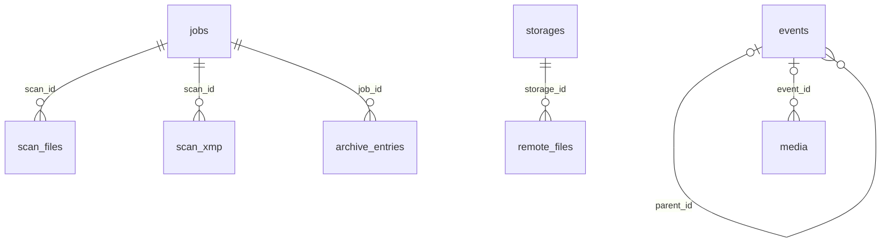

# 데이터 모델

## OMV 종료 작업

`storage-shutdown`은 기존 jobs의 remote 레인을 사용한다. 신규 테이블은 없다. payload는 `requestId`, `aliases`(최대 128개), `requestedAt/deadlineAt/timeoutSeconds`, `targetRevision/configRevision/storageRevision`, `sshConfiguredAtAdmission`, `attempt:{state,count,intentAt,receiptAt}`를 보존한다. count는 0/1이고 `not_started → intent → accepted|rejected|unknown`이며 관찰만 하는 `not_needed|observing_existing`도 가능하다. 크래시로 intent가 남으면 unknown으로 복구하고 재전송하지 않는다.

storageRevision은 `digest({address})`, configRevision은 `digest({url,sensor,script,timeout,storage:storageRevision})`, targetRevision은 `digest({kind:'storage-shutdown',config:configRevision})`다. 토큰은 어떤 리비전에도 포함하지 않는다. deadline은 재시작·별칭 합류로 연장하지 않는다. 공개 result의 `everSshStoppedAfterAttempt`는 accepted/unknown/observing_existing 이후 SSH 중단을 래치해 타임아웃의 부분 확인을 구별하며 `review=1`은 attention 이력에 포함된다.

local 레인의 duplicate-cleanup payload.files[].keeper.kind에 remote가 있으면 종료 접수 및 전송 직전 모두 충돌을 검사한다. 반대 방향의 큐 등록도 동일 write transaction에서 활성 종료를 차단한다. 순수 로컬 keeper 정리는 병행할 수 있다. 초기화·복원 이후 과거 UUID 보존 규칙은 wake와 동일하다.

## OMV 시작 작업 추가

`storage-wake`는 기존 `jobs`의 `remote` 레인을 사용한다. 테이블이나 일반 대기열을 추가하지 않는다. 같은 UUID와 진행 중 동일 설정의 별칭은 하나의 작업 ID에 원자적으로 결합하고 다른 remote/exclusive 작업과 충돌한다. 로컬 scan은 병행 가능하다.

버전 1 payload에는 `requests:[{id,targetRevision}]`(최대 128), `targetRevision`, `storageRevision`, `configRevision`, `archiveConfiguredAtAdmission`, `requestedAt`, `deadlineAt`, `timeoutSeconds`, `attempt:{state,count,intentAt,receiptAt}`를 저장한다. 토큰·계정 raw값·개인키는 저장하지 않는다. public targetRevision은 공용 대상·키/신뢰 증거와 불투명 archive revision/HA 대상 정체성을 결합하며 HA 토큰과 개인키 내용을 제외한다. storageRevision은 SSH 계정·키·신뢰의 비공개 aggregate이고 configRevision은 여기에 HA 설정/토큰을 결합한 비공개 aggregate다. 별도의 credential digest를 노출하지 않는다.

원래 deadline과 정체성은 재시작 때 유지한다. count는 0/1이며 `not_started`에서 durable `intent`를 먼저 commit한 뒤만 단일 앱 전송을 시도한다. intent 복구는 unknown으로 바꾸고 관찰만 한다. accepted/unknown/rejected/observing_existing/not_needed 역시 새 요청으로 되돌리지 않는다. 손상된 ledger는 invalid_operation으로 실패한다. SQLite와 HA 간 exactly-once 전달을 보장하는 구조가 아니며 crash 창에서는 전송이 0회일 수 있다. 공개 결과는 [API 계약](api.md#omv-원격-시작)의 허용 필드만 사용하고 취소 flag를 최신 행에 병합한다. 복원은 기존 활성 작업 failed 규칙을 유지한다. 초기화·복원으로 이력 행이 사라진 이후에는 과거 UUID 보존을 보장하지 않는다.

## 저장 방식

카탈로그 파일은 기본 `/data/catalog.sqlite3`이다. API와 워커가 같은 Docker `catalog` 볼륨을 사용한다. [catalog.py](../backend/catalog.py)의 `SCHEMA`와 `initialize()`가 실제 스키마의 기준이다.

현재 테이블은 **`jobs`, `scan_files`, `scan_xmp`, `events`, `device_names`, `storages`, `media`, `archive_entries`, `remote_files`의 9개**다. 초기 설계에 있던 `media_content`, `source_file`, `device`, `placement`는 별도 테이블로 구현되지 않았으며 콘텐츠·원본·배치 정보 대부분을 `media`에 보관한다. 원격 스토리지 식별과 현재 원격 파일 상태는 `storages`와 `remote_files`에 분리 보관한다.



`archive_entries.media_id`는 논리적 원본 ID이며 외래 키 제약은 없다. 현재 원본이 없어져도 전송 이력을 보존한다. `scan_files.id`와 `media.id`도 DB 외래 키가 아니라 앱이 이동 과정에서 이어 사용하는 ID다.

## 테이블별 내용

### `jobs`: 작업 입력과 결과

| 필드 | 내용 |
| --- | --- |
| `id` | 정수 기본 키 |
| `kind` | `scan`, `move`, `delete`, `duplicate-cleanup`, `aux-cleanup`, `xmp-link`, `upload`, `offload`, `remote-index`, `reset-all` |
| `lane` | `local` (`scan`, `move`, `delete`, `duplicate-cleanup`, `aux-cleanup`, `xmp-link`), `remote` (`upload`, `offload`, `remote-index`), `exclusive` (`reset-all`). 기본 `exclusive` |
| `status` | 기본 `queued`. 처리 중 `running`, 종료 시 `done`·`failed`·`cancelled` |
| `payload` | JSON 객체. 선택 ID, XMP 연결 또는 전송 파일 목록·연결 식별자·작업 토큰 |
| `result` | JSON 객체 또는 NULL. 집계·진행 상황·취소 요청·오류 |
| `created_at`, `finished_at` | 생성·종료 시각 |

부분 유일 인덱스 `one_active_job_per_lane`은 `queued`·`running`을 레인마다 하나만 허용한다. 로컬과 원격은 1+1로 병렬 실행하며 같은 레인의 추가 등록은 409로 거부한다. `jobs_by_lane_status(lane, status, id)`는 조회를 지원한다. `jobs_enforce_exclusive_insert`·`jobs_enforce_exclusive_update` 트리거는 직접 SQL의 INSERT 및 status/lane 변경에도 `exclusive`와 다른 활성 작업의 공존을 차단한다.

`initialize()`는 배타 카탈로그 파일 잠금 안에서 구버전 `jobs.lane`을 추가하고 `backfill_job_lanes()`로 종류별 레인을 채운 뒤 `one_active_job`을 제거한다. 미지의 과거 종류는 `exclusive`로 처리하며 신규 미지 종류 등록은 거부한다. 구버전 DB를 열 수 있도록 공통 `SCHEMA`에는 lane 참조 인덱스·트리거를 두지 않고 마이그레이션 뒤 생성한다. SQLite는 WAL, 연결 timeout 30초 및 `busy_timeout=30000`을 사용한다. 재시작 시 두 레인의 `running`을 함께 `queued`로 복구한다.

### `scan_files`: Incoming 검사 결과

`companions`의 THM·LRV·AAE 엔트리는 stat 성공 시 `size` 바이트를 저장한다. 유일한 소유 원본을 확인한 경우에만 `fingerprint`(JSON dev·ino·size·mtime_ns·ctime_ns 5정수)를 저장한다. 모호·고아·읽기 불가에는 지문을 넣지 않는다. API는 `sizeBytes`를 제공하며 레거시 데이터는 지문의 세 번째 값에서 크기를 읽는다.

중복 정리 payload는 `deleteAux:true`일 때 `files[].auxCompanions`에 path·kind·fingerprint·size를 스냅샷한다. keep/delete-after-move 상태, 화이트리스트 확장자, 단일 참조만 허용하며 보존 사본의 보조 파일은 제외한다. 완료 결과는 `auxDeleted`·`companionReview`를 0부터 집계한다.

보조 파일 일괄 정리 payload는 `scan_id`(null 허용), `files`(path·kind·fingerprint·size)다. 결과 항목은 `deleted`·`absent`·`review`이며 재실행은 deleted/absent 항목을 재사용한다. 최종 job 완료, 최신 검사의 companions disposition 갱신, unmatchedCompanions 제거는 동일 쓰기 트랜잭션이다. review와 XMP는 제거하지 않는다. Jobs의 `absent`는 비주의 영수증이고 `companionReview`는 확인 필요 신호다.

| 필드 | 내용 |
| --- | --- |
| `id`, `scan_id` | 파일 검사 ID(기본 키), 검사 작업 ID(외래 키) |
| `path` | Incoming 기준 상대경로 |
| `fingerprint` | 파일 상태 JSON 배열 문자열 |
| `sha`, `size`, `modified_at` | SHA-256, 바이트 크기, 수정 시각 |
| `thumbnail` | 썸네일 상대 파일명 |
| `companions` | 연결한 XMP·THM·LRV·AAE의 정보 JSON 배열 |
| `status`, `reason` | 판정·이동·삭제 상태와 사용자 확인 사유 |

`scan_files_by_job(scan_id, path)` 인덱스가 있다. 새 검사 결과를 저장하고 작업을 완료하는 트랜잭션에서 이전 검사의 `scan_files`와 `scan_xmp` 행을 삭제하므로 검사별 파일 목록을 누적 보존하지 않는다. Incoming 화면은 최근 **완료한** `scan` 작업을 사용하며, 파일 기록도 현재 남아 있는 검사 행만 조회한다. 과거 검사 작업의 `jobs` 행과 집계 결과는 남는다. 파일 상태와 복구 규칙은 [미디어 처리](media-pipeline.md)를 참고한다.

### `scan_xmp`: 이미 보관한 원본에 대한 XMP 후보

| 필드 | 내용 |
| --- | --- |
| `id`, `scan_id` | 후보 ID와 검사 작업 ID |
| `file` | XMP 경로·파일 상태·메타데이터 등을 담은 JSON 객체 |
| `candidates` | 연결 가능한 `media.id` JSON 배열 |
| `status`, `reason` | 기본 `pending`, 연결 결과와 확인 사유 |

`scan_xmp_by_job(scan_id)` 인덱스를 사용한다. 최신 완료 검사에서 연결되지 않은 후보를 화면에 표시하며 새 검사 완료 시 이전 후보 행은 삭제한다.

### `events`: 최상위 이벤트와 소분류

| 필드 | 내용 |
| --- | --- |
| `id`, `name` | 이벤트 ID와 표시 이름 |
| `folder`, `folder_key` | 아카이브 폴더명, NFC 정규화 후 casefold한 충돌 검사 키 |
| `parent_id` | 상위 이벤트 ID. 최상위는 NULL |
| `start`, `end`, `zone` | 최상위의 날짜 범위와 IANA 시간대. 소분류는 NULL |

유일 인덱스 `event_folder_per_parent`는 `(coalesce(parent_id, ''), folder_key)`다. API는 소분류를 한 단계로 제한하고, 같은 위치의 이벤트·장비 폴더 충돌도 검사한다. 날짜 접두사는 최상위 폴더에만 `YYMMDD_`로 붙인다.

### `media`: 보관 원본, 메타데이터와 분류

| 필드 그룹 | 필드와 역할 |
| --- | --- |
| 식별·파일 | `id`, 유일한 `path`, `name`, `kind`, `sha`, `size`, `fingerprint`, `status` |
| 자동 분석 | `metadata` JSON, `thumbnail`, `capture_time`, `time_source`, `time_verified`, `device` |
| 사용자 보정 | `user_time`, `user_time_source`, `user_device` |
| 원래 위치 | `original_path` — 이동 전 Incoming 상대경로 |
| XMP | `xmp_path`, `xmp_sha`, `xmp_metadata` JSON |
| 분류 | `event_id` 외래 키, `confirmed` 기본 0 |

`media_by_hash(sha, status)`와 `media_by_event(event_id, status)` 인덱스를 사용한다. SHA 자체에는 유일 제약이 없으므로 같은 바이트의 여러 물리 원본을 기록할 수 있다. 상태는 이동 중 `moving`, 로컬 보관 `available`, 로컬 비우기 중 `offloading`, 원격 아카이브 보관(로컬 원본 비움) `archived`, 누락·접근 불가 `missing`을 사용한다.

`archived` 상태의 행은 로컬 `managed`에서 원본과 연결 XMP를 안전하게 비운 뒤에도 이벤트 배정, 메타데이터, XMP 메타데이터와 썸네일을 유지한다. 이벤트 관리 화면과 파일 기록에서 계속 조회·검색할 수 있으며, 아카이브 전송의 Source 업로드 대상에서는 제외한다.

사용자 보정은 자동 분석 값과 분리해서 저장한다. 같은 경로에서 같은 해시 파일을 재분석할 때 이벤트·확정 상태·사용자 보정을 보존한다. 같은 경로의 내용이 다른 해시로 바뀌면 새 콘텐츠로 취급하고 해당 분류·보정과 원래 위치·XMP 연결을 초기화한다. 장비를 수정하거나 다른 이벤트로 배정하면 다시 확정해야 한다.

### `archive_entries`: 파일별 전송·검증 이력

| 필드 | 내용 |
| --- | --- |
| `job_id`, `item_index` | 복합 기본 키. 업로드 작업 ID와 입력 파일 순번 |
| `media_id`, `asset_kind` | 원본 ID와 `media`·`xmp` 구분 |
| `local_path`, `sha`, `size` | 당시 로컬 상대경로, 전송 기준 해시와 크기 |
| `storage_id`, `archive_root`, `target` | 연결 설정 식별자, 전송 당시 설정한 원격 루트 문자열, 대상 상대경로 |
| `outcome` | `uploaded`, `skipped`, `failed` |
| `verified_at`, `recorded_at`, `error` | 검증 시각, 기록 시각, 오류 |

`archive_by_hash(sha, outcome)`와 `archive_by_media(media_id, asset_kind, sha, outcome)` 인덱스가 있다. 부분 실패한 업로드도 성공한 파일의 이력을 별도로 유지한다. `verified_at`은 성공·동일 파일 건너뜀 시 기록하고 실패는 검증 완료로 표시하지 않는다. `archive_root`는 `config['root']`를 그대로 저장하며, SFTP 정규화 결과는 전송 경로 계산에만 사용한다.

### `storages`와 `remote_files`: 안정적 스토리지와 현재 원격 상태

- `storages`는 IP·SSH 키 변경과 무관한 저장소 UUID(`/settings/storage-id`)와 최근 `root_hint`, 생성·확인 시각, 최근 전체 아카이브 루트 인덱싱 시각(`last_indexed_at`)을 보관한다.
- `remote_files`는 `(storage_id, path)`를 기본 키로 하여 원격 스토리지의 현재 파일 스냅샷(`archive_root`, `sha`, `size`, `mtime_ns`, `status`, `first_seen_at`, `verified_at`, `last_seen_at`)을 보관하며 `remote_files_by_sha(sha, status)`와 `remote_files_by_storage_status(storage_id, archive_root, status, path)` 인덱스를 둔다.
- 업로드(`uploaded`·`skipped`) 성공과 원격 아카이브 증분 인덱싱(`remote-index`) 해시 완료 시 `remote_files`를 `present` 상태로 갱신한다. `remote-index`가 취소·단절 없이 완료되면 스캔한 범위(전체 루트 또는 선택한 하위 폴더) 내에서 발견되지 않은 기존 `present` 행만 `missing`으로 전환한다. Safe Offload(`offload`) 실행 중 원격 파일이 사라졌거나 크기가 다른 것으로 확인되어도 해당 행을 `missing`으로 갱신하고 로컬 원본을 삭제하지 않는다.
- 기존 `archive_entries`만 있는 카탈로그를 업그레이드하거나 구버전 백업을 복원하면 `storages.last_indexed_at` 누락 열을 호환 처리하고 검증 완료 이력에서 `storages`와 `remote_files`를 자동 백필한다.

### `device_names`: 촬영도구 이름 규칙

`source TEXT PRIMARY KEY`는 원래 자동 추출 장비명이고 `name TEXT NOT NULL`은 사용자 지정 이름이다. 기존 카탈로그 초기화 시 테이블을 추가한다. 원본 `media.device`는 수정하지 않는다. 표시·경로·검색에 사용할 이름은 `media.user_device → device_names.name → media.device` 순서로 결정한다. 같은 원래 장비명으로 들어오는 새 파일에도 조회 시 적용하며 이름 규칙을 연쇄 적용하지 않는다.

이름 변경은 배정·확정을 해제하지 않으며 이미 예약·기록한 목적지 경로는 유지한다. 백업에 규칙을 포함하고 테이블이 없는 과거 백업 복원 시에는 규칙을 비운다.

## 공통 값과 조회 시 계산

- `fingerprint`는 `[장치 ID, inode, 크기, mtime_ns, ctime_ns]`의 JSON 배열 문자열이다. 해시와 별개로 검사 후 변경 여부를 확인한다.
- JSON 데이터는 SQLite TEXT로 저장하고 코드에서 직렬화·역직렬화한다. 일반 생성 스키마에 JSON CHECK 제약은 없으며 복원 시 주요 필드의 JSON 종류를 검증한다.
- 작업 생성·종료 등 `now()`로 생성한 시각은 UTC ISO 8601 문자열이다. 사용자 지정 촬영 시각도 UTC로 정규화한다. 이벤트 날짜는 `YYYY-MM-DD` 문자열이다.
- DB `size`는 바이트다. `/api/state`의 `incoming[].size`와 `managed[].size`만 십진 MB로 변환한다.
- 장비의 자동·파일별 사용자 문자열은 `media`에, 공통 이름 규칙은 `device_names`에 저장한다. 아카이브 폴더 키는 조회·전송 등록 시 장비 표시명에서 계산한다.
- Source의 논리 경로는 현재 이벤트 폴더와 장비명에서 계산한다. 전송 등록 후에는 `jobs.payload`에 고정된 목적지와 해시를 사용한다.

[records.py](../backend/records.py)는 SQL CTE로 로컬 파일과 업로드 이력을 결합한다. 파일별 이력이 없는 구버전 업로드는 작업 입력으로 보완하고, 완료한 구버전 작업은 `legacy_verified`, 대기·실행은 `pending`, 나머지는 `unknown`으로 표시한다. 이 값은 조회 시 계산하며 `archive_entries`의 실제 저장 결과와 구별한다.

파일의 아카이브 검증 여부는 파일 ID·원본/XMP 구분·**현재 해시**가 일치하는 성공 이력이 있는지 확인한다. 과거 이력만으로 원격 파일의 현재 존재나 내용까지 확인하지 않는다.

## 초기화·마이그레이션·복원

앱은 시작 시 테이블·인덱스를 생성하고 과거 카탈로그에 `scan_files.thumbnail`, `scan_files.companions`, `media.user_time_source`, 원래 경로·XMP 관련 필드가 없으면 추가한다. 별도 마이그레이션 도구나 스키마 버전 테이블은 없다.

백업·복원은 [settings.py](../backend/settings.py)의 SQLite Backup API와 테이블 복사 로직을 사용한다. 복원 시 스키마·JSON·외래 키 무결성을 확인하고, 오래된 백업의 일부 누락 열과 `scan_xmp`·`archive_entries`·`device_names`·`storages`·`remote_files` 테이블 부재를 허용한다. 현재 어느 레인이든 활성 작업이 있으면 백업·복원을 거부한다. 동기 백업·복원은 배타 카탈로그 파일 잠금으로 작업 등록과 상호 배제하며 백업 임시 파일은 잠금과 유휴 검사 이후 생성한다. 구버전 백업의 `jobs.lane` 생략을 허용하고 복원 후 레인을 백필한다. 복원된 활성 작업은 실패로 종료하고 `moving` 원본은 `missing`, `offloading` 원본은 `available`, `deleting` 검사 파일은 `review`로 전환하며 구버전 백업에서 `remote_files`를 자동 백필한다.

## 사용자 데이터 초기화

`POST /api/settings/catalog/reset`은 `모든 데이터 삭제` 확인 문구로 `reset-all` 작업 하나를 등록한다. 다른 활성 작업이 있으면 거부한다. 워커는 managed·썸네일과 카탈로그 볼륨의 임시 파일을 비운 뒤 `clear_catalog()`로 9개 테이블의 모든 행을 한 트랜잭션에서 삭제한다. 이번 작업의 행도 삭제하므로 성공 후 작업 이력은 0개다. 파일 이동 계획이나 별도 완료 기록은 남기지 않는다.

SQLite 본체·WAL·SHM·카탈로그 및 워커 잠금 파일은 실행을 위해 유지한다. 사용자 레코드는 모두 비워진다. incoming 디렉터리와 그 내용, SSH 설정 볼륨·원격 아카이브는 유지한다. 파일 삭제는 트랜잭션 롤백 대상이 아니며 실패 시 이미 삭제한 파일은 복원되지 않는다. 실패 이력은 재실행을 위해 남고, 다음 성공 시 함께 지워진다. 중단된 running 작업은 재시작 때 다시 실행해 남은 파일을 삭제한다.
## 썸네일 캐시 기록

```sql
CREATE TABLE thumbnail_cache (
  sha TEXT PRIMARY KEY,
  status TEXT NOT NULL CHECK (status IN ('ready','failed','skipped_large')),
  source_kind TEXT NOT NULL DEFAULT '', media_kind TEXT NOT NULL DEFAULT '',
  error TEXT NOT NULL DEFAULT '', size_bytes INTEGER, updated_at TEXT NOT NULL
);
CREATE INDEX thumbnail_cache_by_status ON thumbnail_cache(status, updated_at);
```

준비 상태는 `/thumbnails/<sha>-v1.jpg` 일반 파일 실존을 기준으로 판정한다. DB는 실패 사유와 추출 출처(local, remote_photo, remote_video_ssh, remote_video_sftp)를 보존한다. 디스크 파일은 과거 failed 기록보다 우선하며 DB 복원만으로 이미지가 복구되지는 않는다.

`JOB_LANES`의 `thumbnails-local`은 local, `thumbnails-remote`는 remote에 고정된다. 재기동·복원 시 기존 backfill 규칙을 그대로 적용한다. `CATALOG_TABLES`와 백업 복원 화이트리스트에 `thumbnail_cache`가 포함되며 테이블이 없는 구버전 백업도 복원할 수 있다. 전체 초기화는 행과 캐시 파일을 함께 삭제한다.


보유 자산의 최신 업로드 결과는 저장된 상태가 아닌 읽기 전용 파생값이다. 병합된 archive_entries/legacy manifest 이력을 `(file_id, asset_kind, current sha)`로 분할하여 `job_id DESC, item_index DESC`의 첫 결과를 선택한다. 원본과 XMP, 다른 ID의 동일 바이트, 변경 전 SHA는 서로 결과를 물려받지 않는다. 과거 성공 뒤 실패·대기·성공 재시도는 현재 표시만 변경하고 이전 작업 기록은 그대로 유지한다. 파일별 결과 없는 종료 작업은 unknown, 기존 완료 manifest는 legacy_verified로 유지한다. NAS 현재 사본과 다운로드 가능 여부는 기존 활성 루트 remote_files 스냅샷 규칙을 따른다.
