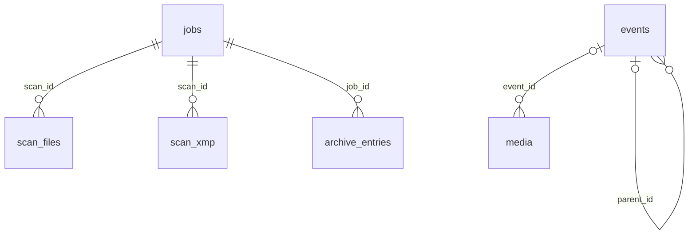

# 데이터 모델

## 저장 방식

카탈로그 파일은 기본 `/data/catalog.sqlite3`이다. API와 워커가 같은 Docker `catalog` 볼륨을 사용한다. [catalog.py](../backend/catalog.py)의 `SCHEMA`와 `initialize()`가 실제 스키마의 기준이다.

현재 테이블은 **`jobs`, `scan_files`, `scan_xmp`, `events`, `media`, `archive_entries`, `device_names`의 7개**다. 초기 설계에 있던 `media_content`, `source_file`, `device`, `placement`, `remote_file`은 별도 테이블로 구현되지 않았다. 콘텐츠·원본·배치 정보 대부분을 `media`에 보관한다.

`archive_entries.media_id`는 논리적 원본 ID이며 외래 키 제약은 없다. 현재 원본이 없어져도 전송 이력을 보존한다. `scan_files.id`와 `media.id`도 DB 외래 키가 아니라 앱이 이동 과정에서 이어 사용하는 ID다.

## 테이블별 내용

### `jobs`: 작업 입력과 결과

| 필드 | 내용 |
| --- | --- |
| `id` | 정수 기본 키 |
| `kind` | `scan`, `move`, `delete`, `xmp-link`, `upload` |
| `status` | 기본 `queued`. 처리 중 `running`, 종료 시 `done`·`failed`·`cancelled` |
| `payload` | JSON 객체. 선택 ID, XMP 연결 또는 전송 파일 목록·연결 식별자·작업 토큰 |
| `result` | JSON 객체 또는 NULL. 집계·진행 상황·취소 요청·오류 |
| `created_at`, `finished_at` | 생성·종료 시각 |

부분 유일 인덱스 `one_active_job`은 `queued`·`running` 전체에 상수 키 하나를 적용한다. 따라서 대기열을 여러 개 쌓는 구조가 아니며, 활성 작업이 있으면 추가 작업 등록을 거부한다. 재시작 시 `running`을 `queued`로 바꾼다.

### `scan_files`: Incoming 검사 결과

| 필드 | 내용 |
| --- | --- |
| `id`, `scan_id` | 파일 검사 ID(기본 키), 검사 작업 ID(외래 키) |
| `path` | Incoming 기준 상대경로 |
| `fingerprint` | 파일 상태 JSON 배열 문자열 |
| `sha`, `size`, `modified_at` | SHA-256, 바이트 크기, 수정 시각 |
| `thumbnail` | 썸네일 상대 파일명 |
| `companions` | 연결한 XMP·THM·LRV의 정보 JSON 배열 |
| `status`, `reason` | 판정·이동·삭제 상태와 사용자 확인 사유 |

`scan_files_by_job(scan_id, path)` 인덱스가 있다. 새 검사 결과를 저장하고 작업을 완료하는 트랜잭션에서 이전 검사의 `scan_files`와 `scan_xmp` 행을 삭제하므로 검사별 파일 목록을 누적 보존하지 않는다. Incoming 화면은 최근 **완료한** `scan` 작업을 사용하며, 파일 기록도 현재 남아 있는 검사 행만 조회한다. 과거 검사 작업의 `jobs` 행과 집계 결과는 남는다. 파일 상태와 복구 규칙은 [미디어 처리](media-pipeline.md)를 참고한다.

### `scan_xmp`: 이미 보관한 원본에 대한 XMP 후보

| 필드 | 내용 |
| --- | --- |
| `id`, `scan_id` | 후보 ID와 검사 작업 ID |
| `file` | XMP 경로·파일 상태·메타데이터 등을 담은 JSON 객체 |
| `candidates` | 연결 가능한 `media.id` JSON 배열 |
| `status`, `reason` | 기본 `pending`, 연결 결과와 확인 사유 |

`scan_xmp_by_job(scan_id)` 인덱스를 사용한다. 최신 완료 검사에서 연결되지 않은 후보를 화면에 표시하며 새 검사 완료 시 이전 후보 행은 삭제한다.

### `events`: 최상위 이벤트와 소분류

| 필드 | 내용 |
| --- | --- |
| `id`, `name` | 이벤트 ID와 표시 이름 |
| `folder`, `folder_key` | 아카이브 폴더명, NFC 정규화 후 casefold한 충돌 검사 키 |
| `parent_id` | 상위 이벤트 ID. 최상위는 NULL |
| `start`, `end`, `zone` | 최상위의 날짜 범위와 IANA 시간대. 소분류는 NULL |

유일 인덱스 `event_folder_per_parent`는 `(coalesce(parent_id, ''), folder_key)`다. API는 소분류를 한 단계로 제한하고, 같은 위치의 이벤트·장비 폴더 충돌도 검사한다. 날짜 접두사는 최상위 폴더에만 `YYMMDD_`로 붙인다.

### `media`: 보관 원본, 메타데이터와 분류

| 필드 그룹 | 필드와 역할 |
| --- | --- |
| 식별·파일 | `id`, 유일한 `path`, `name`, `kind`, `sha`, `size`, `fingerprint`, `status` |
| 자동 분석 | `metadata` JSON, `thumbnail`, `capture_time`, `time_source`, `time_verified`, `device` |
| 사용자 보정 | `user_time`, `user_time_source`, `user_device` |
| 원래 위치 | `original_path` — 이동 전 Incoming 상대경로 |
| XMP | `xmp_path`, `xmp_sha`, `xmp_metadata` JSON |
| 분류 | `event_id` 외래 키, `confirmed` 기본 0 |

`media_by_hash(sha, status)` 인덱스는 중복 후보 조회에 사용한다. SHA 자체에는 유일 제약이 없으므로 같은 바이트의 여러 물리 원본을 기록할 수 있다. 상태는 이동 중 `moving`, 이용 가능 `available`, 누락·접근 불가 `missing`을 사용한다.

사용자 보정은 자동 분석 값과 분리해서 저장한다. 같은 경로에서 같은 해시 파일을 재분석할 때 이벤트·확정 상태·사용자 보정을 보존한다. 같은 경로의 내용이 다른 해시로 바뀌면 새 콘텐츠로 취급하고 해당 분류·보정과 원래 위치·XMP 연결을 초기화한다. 장비를 수정하거나 다른 이벤트로 배정하면 다시 확정해야 한다.

### `archive_entries`: 파일별 전송·검증 이력

| 필드 | 내용 |
| --- | --- |
| `job_id`, `item_index` | 복합 기본 키. 업로드 작업 ID와 입력 파일 순번 |
| `media_id`, `asset_kind` | 원본 ID와 `media`·`xmp` 구분 |
| `local_path`, `sha`, `size` | 당시 로컬 상대경로, 전송 기준 해시와 크기 |
| `storage_id`, `archive_root`, `target` | 연결 설정 식별자, 전송 당시 설정한 원격 루트 문자열, 대상 상대경로 |
| `outcome` | `uploaded`, `skipped`, `failed` |
| `verified_at`, `recorded_at`, `error` | 검증 시각, 기록 시각, 오류 |

`archive_by_hash(sha, outcome)` 인덱스가 있다. 부분 실패한 업로드도 성공한 파일의 이력을 별도로 유지한다. `verified_at`은 성공·동일 파일 건너뜀 시 기록하고 실패는 검증 완료로 표시하지 않는다. `archive_root`는 `config['root']`를 그대로 저장하며, SFTP 정규화 결과는 전송 경로 계산에만 사용한다.

### `device_names`: 촬영도구 이름 규칙

`source TEXT PRIMARY KEY`는 원래 자동 추출 장비명이고 `name TEXT NOT NULL`은 사용자 지정 이름이다. 기존 카탈로그 초기화 시 테이블을 추가한다. 원본 `media.device`는 수정하지 않는다. 표시·경로·검색에 사용할 이름은 `media.user_device → device_names.name → media.device` 순서로 결정한다. 같은 원래 장비명으로 들어오는 새 파일에도 조회 시 적용하며 이름 규칙을 연쇄 적용하지 않는다.

이름 변경은 배정·확정을 해제하지 않으며 이미 예약·기록한 목적지 경로는 유지한다. 백업에 규칙을 포함하고 테이블이 없는 과거 백업 복원 시에는 규칙을 비운다.

## 공통 값과 조회 시 계산

- `fingerprint`는 `[장치 ID, inode, 크기, mtime_ns, ctime_ns]`의 JSON 배열 문자열이다. 해시와 별개로 검사 후 변경 여부를 확인한다.
- JSON 데이터는 SQLite TEXT로 저장하고 코드에서 직렬화·역직렬화한다. 일반 생성 스키마에 JSON CHECK 제약은 없으며 복원 시 주요 필드의 JSON 종류를 검증한다.
- 작업 생성·종료 등 `now()`로 생성한 시각은 UTC ISO 8601 문자열이다. 사용자 지정 촬영 시각도 UTC로 정규화한다. 이벤트 날짜는 `YYYY-MM-DD` 문자열이다.
- DB `size`는 바이트다. `/api/state`의 `incoming[].size`와 `managed[].size`만 십진 MB로 변환한다.
- 장비의 자동·파일별 사용자 문자열은 `media`에, 공통 이름 규칙은 `device_names`에 저장한다. 아카이브 폴더 키는 조회·전송 등록 시 장비 표시명에서 계산한다.
- Source의 논리 경로는 현재 이벤트 폴더와 장비명에서 계산한다. 전송 등록 후에는 `jobs.payload`에 고정된 목적지와 해시를 사용한다.

[records.py](../backend/records.py)는 SQL CTE로 로컬 파일과 업로드 이력을 결합한다. 파일별 이력이 없는 구버전 업로드는 작업 입력으로 보완하고, 완료한 구버전 작업은 `legacy_verified`, 대기·실행은 `pending`, 나머지는 `unknown`으로 표시한다. 이 값은 조회 시 계산하며 `archive_entries`의 실제 저장 결과와 구별한다.

파일의 아카이브 검증 여부는 파일 ID·원본/XMP 구분·**현재 해시**가 일치하는 성공 이력이 있는지 확인한다. 과거 이력만으로 원격 파일의 현재 존재나 내용까지 확인하지 않는다.

## 초기화·마이그레이션·복원

앱은 시작 시 테이블·인덱스를 생성하고 과거 카탈로그에 `scan_files.thumbnail`, `scan_files.companions`, `media.user_time_source`, 원래 경로·XMP 관련 필드가 없으면 추가한다. 별도 마이그레이션 도구나 스키마 버전 테이블은 없다.

백업·복원은 [settings.py](../backend/settings.py)의 SQLite Backup API와 테이블 복사 로직을 사용한다. 복원 시 스키마·JSON·외래 키 무결성을 확인하고, 오래된 백업의 일부 누락 열과 `scan_xmp`·`archive_entries` 테이블 부재를 허용한다. 현재 활성 작업이 있으면 백업·복원을 거부한다. 복원된 활성 작업은 실패로 종료하고 `moving` 원본은 `missing`, `deleting` 검사 파일은 `review`로 전환한다.
